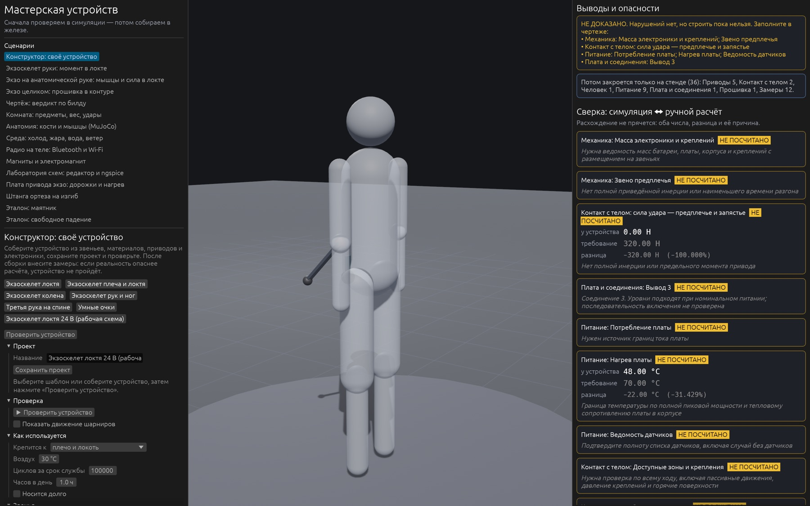
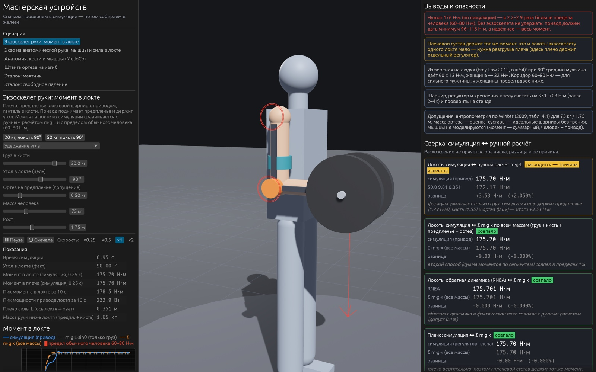
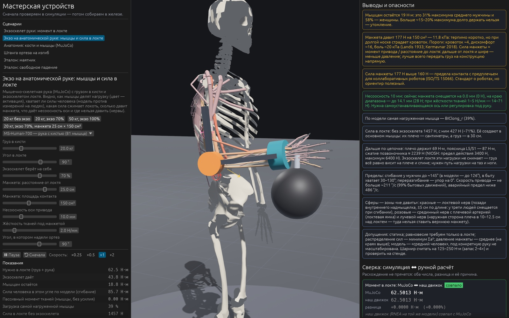
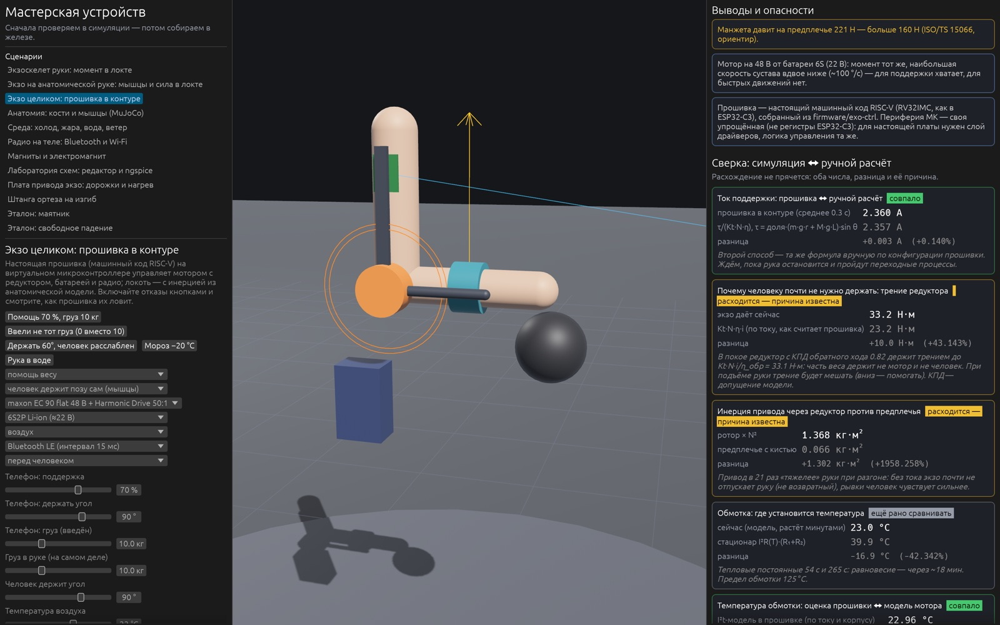
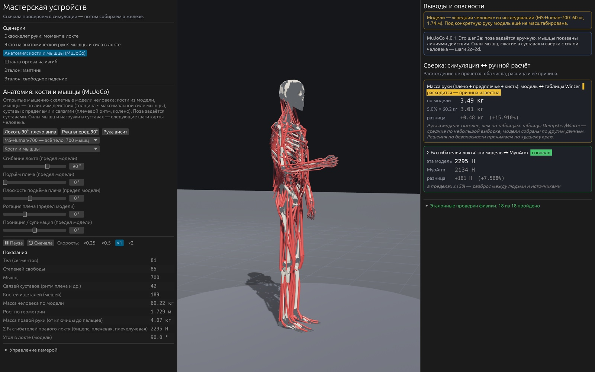

# Мастерская устройств — симулятор

Настольное 3D-приложение на Rust для моделирования устройств, например экзоскелета, третьей руки
или очков с сенсорами. Оно выявляет нарушения и показывает, каких данных не хватает до решения
об изготовлении. Для эталонных задач рядом с результатом есть ручной расчёт или независимая сверка.



## Как собрать своё устройство

1. Запустите `cargo sim`. Приложение откроется в **конструкторе** на согласованной схеме экзоскелета локтя 24 В.
2. Выберите шаблон или соберите своё: звенья, шарниры, материал (пластик или металл), приводы,
   плата, соединения, батарея, крепёж, человек. Проект сохраняется в `projects/*.device`.
3. Нажмите **«Проверить устройство»**. Любая правка сбрасывает прошлый вердикт.
4. Исправьте нарушения и заполните то, что конструктор просит подтвердить.
5. Получив допуск к стенду, соберите его **без человека**, снимите замеры и внесите их в раздел «Замеры».

| Вердикт | Что значит | Что делать |
|---|---|---|
| **НЕ ГОДЕН** | Найдено конкретное нарушение | Строить нельзя, исправить |
| **НЕ ДОКАЗАНО** | Есть открытые обязательные проверки | Закрыть перечисленные пункты до решения об изготовлении |
| **МОЖНО НА СТЕНД БЕЗ ЧЕЛОВЕКА** | Расчёт конструкции сошёлся | Собрать, испытывать с грузом вместо руки, за ограждением, с аварийной кнопкой и ограничением тока. **Не надевать** |
| **ПРОШЁЛ СИМУЛЯЦИЮ И ЗАМЕРЫ** | Закрыты обязательные проверки в области расчёта и замеров этой версии | Следующее решение принимает человек |

**Для приводного экзоскелета на теле высшая ступень сейчас недостижима, и это сделано намеренно.**
Для нагрузки на плечо и локоть не подтверждены применимые пределы травмы. Даже при исполнении
образа в замкнутом контуре нужны замеры той же ревизии и подтверждение реакции на отказы.
Допуск к носке остаётся открытым.

Замер привязан к версии конструкции и образу прошивки. После правки он перестаёт что-либо
подтверждать, пока его не снимут заново.

Своя прошивка: положите `.elf` или `.hex` в `projects/` и укажите файл в проекте. Пример для
RP2040 с входом разрешения: `firmware/bench-enable` (сборка `sh firmware/bench-enable/build.sh`).
Для штатного ESP32-C3 raw flash используйте граф `control.toml` и профиль загрузки,
описанные в [разделе о прошивках](#а--штатные-прошивки-и-питание).



Итоги ночной работы над моделью человека — [docs/REPORT_2026-11-21.md](docs/REPORT_2026-11-21.md).
Вторая ночь (среда, электромагнетизм, схемы, платы, микроконтроллер с прошивкой, Wi-Fi и
Bluetooth) — [docs/REPORT_2026-11-21-night2.md](docs/REPORT_2026-11-21-night2.md).

Устройство кода, источники, лицензии и способ сверки с эталоном — в
[ARCHITECTURE.md](ARCHITECTURE.md). Карта модели человека (кости, суставы, мышцы, силы
в суставах, кожа под манжетами, риски травм) и план её постройки — в
[HUMAN_MODEL.md](HUMAN_MODEL.md).

## Запуск

Нужен Rust ≥ 1.97 (этого требует Bevy 0.20). Проверено на MacBook Pro M1 Pro, macOS 27, Rust 1.100.

Сторонние модели, библиотека MuJoCo и программа ngspice лежат в `assets/third_party/` (~95 МБ):
откуда скачано, версии, контрольные суммы и лицензии — в
[assets/third_party/PROVENANCE.md](assets/third_party/PROVENANCE.md). Сборка ищет
`mujoco.framework` там же; для `bindgen` нужен libclang из Xcode Command Line Tools.

Прошивки старых сценариев уже собраны (`assets/firmware/*.elf`). Чтобы пересобрать их после правки кода в
`firmware/` (или кнопкой «Пересобрать прошивку» в окне), нужна цель RISC-V для rustc:

```bash
rustup target add riscv32imc-unknown-none-elf
```

```bash
sh firmware/build.sh
```

```bash
cargo sim --offline
```

`cargo sim` — короткая форма `cargo run -p workshop` (алиас в `.cargo/config.toml`).
Первая сборка — около 7 минут (собирается Bevy), занимает ~8 ГБ в `target/`; дальше
запуск за секунды.

Тесты без окна из корня `sim-next`. Полную приёмку запускает владелец.

```bash
cargo test --offline --workspace
```

Отчёт по всем эталонным проверкам с числами, ошибками, допусками и допущениями:

```bash
cargo verify --offline
```

Снимок окна без рук и без экрана (рендер в текстуру на GPU — работает и при
заблокированном экране):

```bash
cargo sim -- --scenario exo_arm --preset 1 --screenshot exo50.png --after 7
```

Флаги: `--scenario constructor|exo_arm|exo_anatomy|exo_loop|build_review|room|anatomy|environment|radio_body|magnets|circuit_lab|pcb_board|beam|pendulum|free_fall`,
`--choice id=N` (вариант в списке сценария, например `--choice model=1` — MyoArm,
`--choice medium=1` — рука в воде), `--preset N` (номер кнопки готового варианта),
`--action id@секунды` (нажать кнопку сценария, например `--action check@1`),
`--screenshot файл.png`, `--after секунды`.

Посмотреть, что внутри модели тела (суставы, пределы, тела и массы, мышцы и их силы):

```bash
cargo run -p sim-mujoco --example inspect -- myoarm elbow
```

Первый аргумент — `full`, `arm` или `myoarm`, второй — фильтр по имени.

### Мир с приводами и датчиками без окна

```bash
cargo run --offline -q -p sim-cli --bin sim-run -- devices/04-wall-switch/world.toml --duration 0.26 --commands devices/04-wall-switch/commands.csv --json
cargo run --offline -q -p sim-cli --bin sim-run -- devices/05-camera-tracker/world.toml --duration 0.184 --commands devices/05-camera-tracker/commands.csv --json
```

`sim-run` ищет ближайшую папку `catalog` рядом с файлом мира и выше по дереву. Путь
можно задать через `--catalog <папка>`. Используются подкаталоги `drives` и `sensors`
для компонентов, объявленных в мире. Командный CSV содержит заголовок `time_s,channel,value`
и строки с полными именами входов, как в примерах. Время округляется до наносекунды.
Моменты идут по возрастанию, у одного канала может быть одна команда на момент.
Нулевой пакет действует до первого такта, остальные после событий указанного момента.
Каждое значение держится до обновления своего канала. Единицы команды привода задаёт его режим,
например доля скважности для `pwm`. Вход без привода принимает обобщённую силу в СИ.

`--log <новый файл>` сохраняет двоичный журнал, `--csv <новый файл>` выдаёт его таблицу.
`--replay <журнал>` берёт зерно и команды из записи, проверяет совпадение журнала.
Для сверки используйте тот же мир, каталог и длительность. Ключи `--replay` и `--commands`
взаимоисключающие.
Режимы `--mode fast|realtime|step` и `--snapshot-at <с>` остаются доступны.

В JSON есть последние значения команд, наблюдений и каналов для оценщика в `channels` с отметками
времени и `valid`. `null` означает, что канал ещё не публиковался. Для кадра записывается отпечаток
пикселей. `component_failure` содержит причину остановки компонента. `simplifications` и
`blocks_proof` показывают ограничения. `completed` означает достижение конца прогона,
а `proof_status: "not_analyzed"` остаётся до подключения оценки опасностей.

На стенде MG90S при 4.8 В получились 8.72665 рад/с на холостом ходу и 0.17720 Н·м на упоре.
Ток около 0.700 А, энергия за 60 мс около 0.20155 Дж. После снятия питания ток обмотки падает
до нуля, а привод отходит от упора. Клавиша смещается от механического контакта.
Рабочая сетка устройства 4 — 1 МГц. Команда CSV в 239.999 мс снимает питание в 240 мс.
При смене сетки нужно пересчитать момент команды. Сдвиг даже на один такт влияет на кривую
момента при выборе люфта, точность которой требует дополнительной сверки.
На оптическом стенде центр мишени совпал с независимой проекцией с ошибкой 0.0201 px,
экспозиция 16 мс и задержка 8 мс проверены по времени доставки. Оба журнала воспроизводятся
побитово. Допуски, источники и границы проверки описаны в [разделе 7.7](ARCHITECTURE.md#77-состояние-этапов).

### Привод за передачей

Передачи `[[transmissions]]` (ремень, шестерня, винт) задаются мягкой связью MuJoCo. Если привод
стоит на лёгком входном валу, этот вал оказывается между жёсткостью привода и связью передачи,
и проверка шага требует мегагерцы. Лёгкий вал описывается как безынерционный:

- привод ставится на выходную ось, `gear_ratio` умножается на 1/`ratio` передачи;
- `gear_efficiency` и `backward_efficiency` умножаются на КПД передачи;
- податливость передачи складывается с `coupling_stiffness` последовательно: 1/K = 1/(K_привода/ratio²) + 1/K_передачи;
- люфт передачи прибавляется к `backlash`, люфт привода умножается на `ratio`;
- энкодер на валу привода ставится на выходную ось с шагом, умноженным на `ratio`.

Проверка шага распознаёт привод на входе передачи и подсказывает этот приём. Пример: плечо и локоть
в [devices/claude-arm](devices/claude-arm/device.toml).

Вращательный привод на поступательной оси (рейка, винт, ремень с кареткой) задаётся параметром
`linear_travel_m_per_rev`: ход за оборот выходного вала. Передаточное число делится на ход/2π,
параметры связи задаются в единицах хода. Пример: губа схвата в
[devices/claude-arm](devices/claude-arm/device-gripper.toml).

### Внешние силы и приводы

Пробный шаг привода держит внешние силы прошлого шага: стимулы, усилия без привода, процессы, другие
группы приводов. Внешняя команда (толчок, стимул задачи) вносится после фазы приводов, поэтому шаг, на
котором она меняется, привод считает по прежней силе. Сверка отклика на следующем шаге сравнивает факт
с прогнозом. Если ошибка больше 1 % импульса, прогон останавливается и называет нужную частоту физики.

Резерв выхода контроллера для привода задаётся числом или `fallback = "hold"`. Второй вариант
держит последнее значение, ушедшее на выход, как шинная серва при потере связи.

Расчётное показание задачи `formula = { kind = "body_point", body = "<устройство>/<звено>",
local_m = [x, y, z], axis = 0|1|2 }` даёт мировую координату точки, жёстко связанной со звеном,
например кончика инструмента.

Задание с контуром пишет координаты и скорости всех соединений на каждом шаге физики, а журнал
процессов физики режима — строку на каждой границе. На сотнях килогерц это гигабайты на секунду модели.
Профиль задания может проредить обе записи: `joint_state_hz = 1000` и
`[mode_physics] "режим" = { case = "...", witness = "...", journal_hz = 1000 }`. Строки журнала процессов
внутри окна сливаются, журнал остаётся сплошным, события, блокеры и опасности сохраняются. `journal_hz`
допустим только для свидетеля по координате, скорости или смещению. Без полей запись прежняя.

`truth_hz = 1000` прореживает ряды истины (приводы пишут их на каждом шаге): из каждого окна по ряду
остаются первое значение, минимум и максимум, поэтому проверки диапазонов видят те же экстремумы.
Контакты для просмотра (`--view`) тогда пишутся раз в окно. Отладочный прогон одного пути сигнала:
`--case режим --path путь`.

Регулятор привода по умолчанию видит выход сустава, как серва с датчиком на выходном валу. Запись
каталога с `regulator_feedback = "motor"` описывает драйвер с энкодером мотора (EPOS4, CubeMars):
люфт и податливость передачи остаются вне контура и дают ошибку выхода, а не автоколебания.

Жидкость — процесс физики режима `kind = "liquid"`: осесимметричные сосуды (`profile_m` — профиль
полости), слив через срез горла, струя, пролив и вес воды на сосуд. Публикует объёмы сосудов,
`<имя>/мимо`, `<имя>/поток` и, если задана цель `goal`, запрещённое событие `<имя>/цель`. Пример —
[кронштейн](devices/claude-arm-2/case.toml).

## Управление камерой

| Что | Как |
|---|---|
| Осмотреться | держать правую кнопку мыши и вести мышью |
| Идти | W A S D |
| Вниз / вверх | Q / E (или пробел) |
| Быстрее | Shift |
| Скорость шага | колесо мыши |
| Посмотреть на устройство | F |
| Вид по умолчанию | R |

## Сценарии

**Конструктор: своё устройство.** Механика с худшим наклоном тела, детали из пластика и металла
(статика, усталость, ползучесть, крепёж, печатаемость), приводы, удар, зажим и зазоры по
ISO/TS 15066 и ISO 13854, нагрузка на человека, питание, батарея (КЗ, провод, нагрев, BMS),
соединения платы, запуск прошивки и замеры. Шаблоны: экзоскелет локтя, плечо + локоть, колено,
руки и ноги, третья рука, умные очки и рабочая схема локтя на 24 В. Первые пять шаблонов намеренно
не подогнаны и получают «не годен» по настоящим причинам.

**Чертёж: вердикт по билду.** Единая проверка всего устройства: прочность, плата, давление
на кожу, отказ привода с грузом и реакция настоящей прошивки на аварийную кнопку, обрыв
датчика, потерю связи, зависание и заклинивание. Исходов три:

* **НЕ ГОДЕН** — найдено конкретное нарушение;
* **НЕ ДОКАЗАНО** — нарушений нет, но не все обязательные опасности посчитаны;
* **ПРОШЁЛ СИМУЛЯЦИЮ** — посчитаны и выдержаны все. Это допуск к стенду без человека, а не
  гарантия безопасности.

Этот сценарий проверяет один экзоскелет локтя с настоящей прошивкой в контуре. Своё устройство
проверяет конструктор. Приёмка: `crates/sim-scenarios/tests/dangerous_builds.rs` (заведомо опасные
билды обязаны провалиться именно по своей опасности) и `tests/false_green.rs`.

**Комната: предметы, вес, удары.** Пол, стены, стол, стул, столик, книга, бутылка, картонная
коробка и гиря со своей массой, трением и упругостью (контакты считает MuJoCo). Варианты: гиря
падает на стол, катится в коробку, стоит на краю лёгкого столика. Сверки с ручным расчётом: вес
на полу, скорость удара √(2gh), порог опрокидывания m·(x − a) = M·a, переход шара в качение 5/7·v₀,
порог трения tan α = μ, удар тяжёлого о лёгкое, отскок. Пик силы в точке зависит от заданной
мягкости удара, поэтому это оценка, а не прочностной расчёт.

**Экзоскелет руки: момент в локте.** Плечо, предплечье, локтевой шарнир с приводом,
гантель в кисти. Привод (ПИД, 2 кГц) поднимает предплечье по траектории минимального
рывка и держит угол. Кнопки «20 кг, локоть 90°» и «50 кг, локоть 90°». На экране:

* момент в локте из симуляции ↔ ручной расчёт m·g·L ↔ ручной расчёт по всем массам
  Σ m·g·x ↔ обратная динамика (RNEA);
* предел обычного человека 60–80 Н·м (кольца на суставах зелёные/жёлтые/красные);
* на какой момент считать шарнир и крепления (запас 2–4×);
* график момента: подъём, пик и выход на статику, полоса предела человека;
* режим «Подъёмы 30° ↔ 120°» — видно, что в движении момент выше статики.

| Груз | m·g·L | Σ m·g·x (все массы) | Симуляция | Вывод |
|---|---|---|---|---|
| 20 кг | 68.9 Н·м | 72.4 Н·м | 72.4 Н·м | на пределе человека |
| 50 кг | 172.2 Н·м | 175.7 Н·м | 175.7 Н·м | в 2.2–2.9 раза выше предела, нужен привод |

Формула m·g·L занижает на 3.5 Н·м: она не учитывает вес предплечья, кисти и ортеза. Это
показано как «расходится — причина известна», а второй ручной расчёт по всем массам
совпадает с симуляцией до 0.01%.

**Экзо на анатомической руке: мышцы и сила в локте.** Мышечно-скелетная рука (MS-Human-700
или MyoArm) с гирей в кисти и экзоскелетом локтя: привод, штанга, манжета на предплечье.
Ползунки: груз, угол, доля помощи экзоскелета, положение и площадь манжеты, несоосность оси,
жёсткость тканей, угол надевания. На экране:

* мышцы окрашены по нагрузке (статическая оптимизация, min Σa²);
* момент в локте тремя способами (MuJoCo, наш движок, сумма по костям) — совпадают;
* сила человека: модель против измерений на людях (Frey-Law 2012) — кривая по углу;
* сила в самом локте без экзоскелета и с ним, сила и давление манжеты на кожу, нужная
  площадь манжеты, паразитная сила от несоосности, мощность привода;
* зоны нервов «не давить» (локтевой, срединный с артерией, лучевой), пределы и скорость;
* дальше по цепочке — момент в плече и пояснице и сжатие позвоночника L5/S1 против
  пределов NIOSH (экзоскелет локтя их не снимает);
* пороги — из литературы, с источниками (`crates/sim-scenarios/src/human_limits.rs`).



**Экзо целиком: прошивка в контуре.** Настоящая прошивка — машинный код RISC-V
(`firmware/exo-ctrl`, Rust) — исполняется на виртуальном микроконтроллере «как ESP32-C3»
(`sim-mcu`: ядро RV32IMC 160 МГц, таймер, АЦП, ШИМ, UART, радио, сторожевой таймер) и
управляет симулированным железом: H-мост → мотор maxon EC 90 flat с Harmonic Drive 50:1
(или CubeMars AK80-64) с нагревом обмотки → локоть с массой и инерцией предплечья из
анатомической модели; батарея Li-ion (ячейки LG M50); связь с телефоном по Bluetooth LE
или Wi-Fi с потерями и задержками; среда (мороз, вода). Обмен каждые 25 мкс, ~20× быстрее
реального времени. Кнопки отказов: аварийная кнопка, обрыв датчика угла, заклинивание,
пропала связь, зависание прошивки (сторожевой таймер). Конфигурацию прошивки (усиления,
пределы, тепловую защиту) можно править текстом прямо в окне; «Пересобрать прошивку»
компилирует `firmware/` и загружает новый код в МК. Сверки: ток поддержки ↔ ручной расчёт,
оценка температуры обмотки в прошивке ↔ тепловая модель мотора, реакция на аварийную
кнопку, задержка Bluetooth ↔ формула.



**Среда: холод, жара, вода, ветер.** Человек в экзоскелете (скелет MS-Human-700, кожа
окрашена по температуре): терморегуляция по двухузловой модели Gagge (ASHRAE 55) за время
пребывания — ядро, кожа, пот, дрожь, потеря воды; ветро-холод и минуты до обморожения,
индекс жары, Бофорт; погружение в холодную воду (Hayward). Устройство: рама на морозе/на
солнце у кожи (ISO 13732), подкладка, конденсат при входе в тепло, пределы Li-ion и
электроники, пластики на солнце, охлаждение мотора ветром/водой → сколько момента привод
даёт длительно.

**Радио на теле: Bluetooth и Wi-Fi.** Устройство на предплечье ↔ телефон: потери у тела по
измерениям IEEE 802.15.6, тело за спиной (сигнал огибает корпус), вода над устройством (две
модели проницаемости воды), чувствительность ESP32-C3 по даташиту; живой пакетный канал —
события соединения BLE, повторы, разрывы, задержки.

**Магниты и электромагнит.** Сила между магнитами (двумя независимыми интегралами и против
«двух диполей»), магнит на стали (метод изображений против замера K&J), электромагнит с
кривой B–H и насыщением (сила двумя способами, нагрев катушки), магнит датчика угла локтя
AS5600 (окно зазора). Силовые линии в 3D.

**Лаборатория схем: редактор и ngspice.** Нетлист SPICE пишется прямо в окне; готовые
примеры — RC, RLC, диоды, выпрямитель, светодиод, ключ мотора с ШИМ, H-мост, понижающий
преобразователь, делитель батареи для АЦП, термистор. Наш решатель считает кривые;
«Сверить с ngspice» прогоняет тот же текст во внешней программе и показывает расхождение.

**Плата привода экзо: дорожки и нагрев.** H-мост, шунт, стабилизатор, МК с линией к антенне
на плате FR-4: нагрев дорожек по IPC-2221, температура переходов, падение напряжения,
волновое сопротивление линии 2.4 ГГц двумя формулами.

**Анатомия: кости и мышцы (MuJoCo).** Открытые мышечно-скелетные модели человека,
посчитанные движком MuJoCo: всё тело MS-Human-700 (700 мышц), MyoArm из MyoSuite
(рука, 63 мышцы) и рука MS-Human-700 с подробной кистью (81 мышца). Кости — сетки из
моделей, мышцы — по линиям действия (толщина ~ максимальной силе мышцы), суставы — с
пределами и связями (плечевой ритм, колено). Поза задаётся ползунками суставов. Сверки:
масса руки по модели ↔ таблицы Winter, и модели между собой (масса руки, сила сгибателей
локтя). Это шаг 2a карты человека; силы мышц и нагрузки в суставах — дальше.



**Штанга ортеза на изгиб.** Боковая штанга предплечья под весом груза: прогиб МКЭ ↔
P·L³/(3EI) ↔ многотельная цепочка ↔ эластика Эйлера (большие прогибы); напряжение
σ = M·c/I против предела текучести, запас прочности. Тонкая штанга 20×10 мм под 50 кг
даёт σ = 515 МПа (больше предела 276 МПа) — красный вывод; 12×30 мм на ребро — запас 2.9×.

**Эталон: маятник.** Период ↔ точная формула через эллиптический интеграл ↔ формула малых
углов (при 120° она ошибается на 37% — это показано). Смена интегратора на явный Эйлер
показывает, как растёт энергия.

**Эталон: свободное падение.** Шар-свободное тело падает на пол, рядом каркасный
«призрак» положения по формуле; время и скорость удара ↔ √(2h/g) и √(2gh).

Скриншоты всех сценариев — в [docs/screenshots](docs/screenshots).

## Что работает

* Окно с 3D-сценой на Bevy: пол с сеткой, солнце с тенями, заполняющий свет, свободная
  камера, 15 сценариев, переключение на лету; редактор текста (нетлист, конфигурация прошивки),
  кнопки действий и отказов, журнал UART, несколько графиков.
* Своё ядро многотельной динамики (Featherstone): вращательные, поступательные,
  свободные (6 DoF, кватернион) и жёсткие шарниры; RNEA, ABA, матрица масс; явный и
  полунеявный Эйлер, RK4.
* МКЭ балки Эйлера–Бернулли; эластика Эйлера для больших прогибов.
* **430 эталонных сверок вторым независимым способом** (`cargo verify`): механика 18, среда и
  человек 95, электромагнетизм 59, схемы 45, микроконтроллер 43, радио 12, материалы 52, батарея 29,
  приводы 44, платы 20, мышцы 13. База перед третьим ТЗ зафиксировала **1192 теста и 2 пропуска**.
  [Базовый снимок Т0](docs/DEPTH_BASELINE.md). Пять мест, где модель человека
  расходится с измерениями, вынесены отдельным списком и в «прошёл» не участвуют.
* Платы с запуском машинного кода: ESP32-C3, RP2040, STM32F103, ATmega328P.
* Прошивка в контуре: настоящий машинный код RISC-V (RV32IMC) на своём эмуляторе,
  ~20× быстрее реального времени, вместе с мотором, локтем, батареей и радио.
* Наш движок совпадает с MuJoCo на моделях тела (до 147 звеньев) до ~1e-15; мышца MuJoCo
  переписана на Rust и совпадает с оригиналом до 4e-16 (результаты — HUMAN_MODEL.md, §9).
* MuJoCo 4.0.1 подключён к Rust напрямую (C API через `bindgen`, crate `sim-mujoco`);
  модель MyoArm собирается из фрагментов MyoSuite тем же механизмом, что их Python-скрипт.
* Панель сверки «симуляция ↔ ручной расчёт» со статусами, выводы, график, список
  эталонных проверок прямо в окне.
* Съёмка кадра без экрана (`--screenshot`).

### Замкнутые прогоны этапа 3

```sh
cargo build --offline -p sim-control --bin sim-control-worker
cargo run --offline -q -p sim-cli --bin sim-run -- devices/01-elbow-assist/closed-world.toml --task devices/01-elbow-assist/tasks/acceptance.toml --json
cargo run --offline -q -p sim-cli --bin sim-run -- devices/04-wall-switch/world.toml --task devices/04-wall-switch/tasks/acceptance.toml --json
cargo run --offline -q -p sim-cli --bin sim-run -- devices/05-camera-tracker/world.toml --task devices/05-camera-tracker/tasks/acceptance.toml --json
cargo run --offline -q -p sim-cli --bin sim-run -- devices/07-balance-cart/closed-world.toml --task devices/07-balance-cart/tasks/acceptance.toml --json
cargo run --offline -q -p sim-cli --bin sim-run -- devices/01-elbow-assist/closed-world.toml --task devices/01-elbow-assist/tasks/acceptance.toml --matrix full --jobs 4 --checkpoint /tmp/sim-stage3-matrix --json
cargo test --offline -p sim-cli --test closed_control_devices -- --nocapture
```

`--task` читает профиль эксплуатации, проводку и расписание каждого опыта. В JSON
выводятся разрешённая топология, отпечатки входов, `Evidence`, фактические времена,
физические метрики и сверка с численным эталоном. `--case <режим>` ограничивает
выполнение одним режимом и позволяет выгрузить его штатный журнал через
`--log <новый файл>` или `--csv <новый файл>`. При этом открытые строки остаются
в общей матрице. Код завершения 0 означает, что запущенные физические прогоны
дошли до горизонта. Вердикт проверяется отдельно в поле `closed_loop`.

`--matrix full` разворачивает обязательные режимы и одиночные отказы по разрешённым
путям. Индивидуальные настройки имеют приоритет, остальные берутся из `[fault_sweep]`.
Поле `coverage` показывает, сколько строк из требуемых дошли до горизонта с
подтверждённым применением отказа. `Pass` требует полного покрытия. Для режимов,
ожидающих модели этапа 4, пересечений воздействий и отсутствующих механизмов
в строке сохраняется причина `NotAnalyzed`. Отсутствие подтверждения фактического
отказа видно в `missing`.

`--jobs` задаёт число независимых прогонов в потоках. По умолчанию используется
доступное число потоков. Для возобновления повторите команду с тем же `--checkpoint`.
Каталог по отпечатку связывает строки со сборкой, данными, зерном и эталонами.
Запись завершённой строки публикуется атомарно. Для `Pass` требуется свежее
исполнение. Диагностические результаты внешнего процесса воспроизводимы при
неизменном поведении программы и её окружения.

| Сборка | Что посчитано и чем сверено | Граница результата |
|---|---|---|
| 1 | Восемь режимов на исходном ELF. На каждом из 4 800 отсчётов нормальная сила совпала с эталоном (0 Н), состояние моста совпало. Маска доставленных флагов совпала в 4 795 отсчётах. При обрыве датчика расходятся 2 отсчёта, при аварийной кнопке 3, максимальная разность масок в обоих режимах 4 | Эталон доставляет телеметрию в слотах BLE по 15 мс, перенос использует маршрут с фиксированной задержкой 25 мкс. Упор допускает выход за геометрическую границу. Погружение, препятствие и механическое заклинивание ожидают этапа 4 |
| 4 | Прошивка ESP32-C3 читает угловой вход ADC и меняет LEDC. На сетке 1 МГц измерены ход рычага, сила между геомами и провал тока при обрыве и отключении питания. Нормальная сила пары достигает 0.495 Н, ход клавиши 19.84° при эскизном пределе 12° | Выход LEDC подключён как усреднённый мост MG90S при 4.8 В. Штатный импульсный интерфейс, реальная батарея и внутренняя электроника сервы требуют отдельного подтверждения |
| 5 | Внешний процесс получает RGB-кадры. Пределы задержек сверены с независимым округлением до такта. СКО ошибки 0.112 рад штатно, 0.175 рад при дополнительных 80 мс, 0.210 рад без обратной связи | Синтетические кадры и стендовый профиль задержек требуют измерений с физической камерой |
| 7 | Регулятор из данных использует три канала IMU и скорости двух колёс. Максимум наклона 3.08° в опыте 0.7 с, без обратной связи к концу около 90°, при обрыве гироскопа около 60° | Контакт, потери, масса, диапазон начальных условий и возмущений требуют проверки на стенде |

Манифест [devices/stage3.toml](devices/stage3.toml) задаёт контрольные случаи.
В отрицательном опыте ELF меняет ШИМ по внутреннему счётчику. Парный прогон
меняет измерения при той же последовательности команд. Оценщик также проверяет
постоянный выход и заранее заданную последовательность на аналитической каретке.

## Контакт и процессы этапа 4

`sim-run --task` принимает задание версии 1 с полем `process_profile`. Профиль выбирает
файлы опытов. Они задают именованные пары материала, сетки, модели, состав сменных насадок,
критерии и временные окна. JSON содержит отпечатки входов, реакции и события на каждой сетке,
измерения, сравнение с эталоном и итоговый вердикт. Командой `--case` можно выбрать один опыт.
`--jobs N` запускает независимые опыты одного профиля параллельно со стабильным порядком в отчёте.

```sh
cargo run --offline -q -p sim-cli --bin sim-run -- devices/04-wall-switch/stage4/world.toml --task devices/04-wall-switch/stage4/acceptance.toml --json
cargo run --offline -q -p sim-cli --bin sim-run -- devices/06-xyz/world.toml --task devices/06-xyz/acceptance.toml --json
cargo run --offline -q -p sim-cli --bin sim-run -- devices/01-elbow-assist/stage4/world.toml --task devices/01-elbow-assist/stage4/acceptance.toml --jobs 2 --json
cargo test --offline -p sim-cli --test process_devices
```

Манифест включает отрицательные опыты. Успешное завершение программы означает, что она получила
полный журнал. Сравнение с эталоном и вердикт находятся в полях `reference` и `outcome`.
У неизвестной пары материалов запуск отклоняется, это приводит к коду 1 для общего отчёта устройства 4.
Режимы `jam`, `water`, `obstacle` сверяют идеализированный расчёт на всей сетке эталона.
В общем отчёте геометрические режимы публикуют `model_sensitivity` с разностью двух живых кривых
для каждого столбца. Режим `water-radio` использует BLE без записанных слотов доставки.
Для `weld` журнал содержит знаковые силу и момент на сменном звене в мировой системе
относительно якоря в начале завершённого интервала.
Сменщик насадок `kind = "coupler"` берёт команды из расписания `commands` или из замка
`lock = { signal, max_age_ns }`. Сигнал замка — выход контроллера вида `goal` или показание на шине:
1 замыкает стык с насадкой, стоящей в своём держателе под носителем, 0 отпускает. Замок срабатывает
по фронту, невалидная или устаревшая команда уровень не меняет. Замок с шины ставится физикой режима
в задании с контуром (`mode_physics` профиля), пример — смена насадок руки в [devices/claude-arm](devices/claude-arm/README.md).
Стендовый результат и данные для проверки физической применимости указаны в [§ 7.7 архитектуры](ARCHITECTURE.md#77-состояние-этапов).

## Человек в общем мире, этап 5

Манифест [devices/stage5.toml](devices/stage5.toml) задаёт три контрольных устройства, постановку
с переименованными идентификаторами, минимальное покрытие и ожидаемые отказы. Участник, оси
движения, привязки, тканевые прокси, источники питания, сетки и события загружаются из данных.
Рама помощи исполняет существующий ELF через плату. Тросовый механизм получает команды общего
контроллера, рама датчиков движется на физических контактах и передаёт пакеты в общий BLE-канал.

```sh
cargo run --offline -q -p sim-cli --bin sim-run -- devices/01-elbow-assist/stage5/world.toml --task devices/01-elbow-assist/stage5/acceptance.toml --case nominal --json
cargo run --offline -q -p sim-cli --bin sim-run -- devices/02-cable-assist/world.toml --task devices/02-cable-assist/acceptance.toml --case nominal --json
cargo run --offline -q -p sim-cli --bin sim-run -- devices/03-wearable-sensors/world.toml --task devices/03-wearable-sensors/acceptance.toml --case nominal --json
cargo test --offline -p sim-cli --test interaction_devices
```

Задание версии 1 задаёт `interaction_profile`. В профиле `base` указывает исходную постановку,
`cases` задаёт порядок вариантов, `overlay` переопределяет поля. Массивы заменяются целиком.
Три сетки пересобираются при каждом варианте. Путь без `--case` исполняет матрицу, включая опасные
варианты. Код 1 означает нарушенное требование, провал численной сверки или неполный выбранный
опыт. Код 2 выдаётся при ошибке входа. Код 0 означает выполненный численный опыт, статус
готовности читается из `cases[].readiness`. Для повторения указанного в JSON худшего варианта
передайте `--case` и `--seed` из отчёта.

JSON содержит отпечатки входов и журналов, проверку сходимости пиков, импульсов, длительности и
дрейфа, находки по площадкам и питанию, диагностические пределы ткани и пять прежних расхождений.
Сценарные бюджеты давления, защемления, рывка и температуры относятся к испытательной постановке.
Реальная площадь пятна, пороги ткани и доступная энергия при отказе требуют проверенных данных.
При опасной или неограниченной энергии питания на теле верхняя готовность закрыта.

## Кампания и корпус опасных сборок (этап 6)

Исправления независимой проверки внесены. Статус этапа определит повторная приёмка.

```sh
cargo build --offline -p sim-control --bin sim-control-worker
cargo run --offline -q -p sim-cli --bin sim-run -- --campaign devices/stage6.toml --checkpoint "$STAGE6_CHECKPOINT" --json
cargo run --offline -q -p sim-cli --bin sim-run -- --campaign devices/stage6/corpus.toml --json
```

Для возобновления семи сборок передайте тот же каталог `STAGE6_CHECKPOINT`. Для адресного
живого повтора добавьте `--repeat <worst_run_key>` и уберите `--checkpoint`. В JSON
`status` показывает состояние кампании, `verdict` — исход каждой сборки, а `coverage`
сохраняет обязательные строки. У неисполненных строк контура причина находится в
`detail.profile.evidence.cases[].missing`, у опытов процессов — в
`detail.profile.cases.<режим>.convergence.trials[].missing`. Отчёт хранит отпечатки журналов
и фактические времена инъекций. Счётчик `resumed` относится к работе с контрольной точкой.

Постановка `stations.*.experiment` может ссылаться на задание контура, процессов
или взаимодействия. Для выполненной строки сверяются режим, путь, сетка, зерно,
горизонт и факт применения запрошенного отказа. Ссылочные серии используют общий
расчёт статистики. JSON хранит долю успеха, медиану, 95-й перцентиль и худший
прогон для однородных показателей, а для обоснованной независимой серии — доверительный
интервал. Исполнено 329 из 351 строки, включая 54 новых сочетания с заклиниванием,
погружением и ударом. Причины остальных 22 строк приведены
в [архитектуре этапа 6](ARCHITECTURE.md#чего-пока-нет-на-этапе-6).

Подтверждены 29 из 29 классов [корпуса](devices/stage6/acceptance.toml). Для перегрузки,
разряда, нагрева и аварийного останова расчёт сверяется с R–L, моделью Тевенина,
балансом Джоуля и энергией обмотки. Для отказов контура проверяются подтверждённая инъекция,
исполнительный ряд после выдержки и парная схема с нулевым резервом. Идентичность графа
проверяется по отпечатку файла на пути фактически принятой команды. Горячее касание,
доступный постоянный ток и расхождение с синтетическим рядом имеют парные опыты,
независимый расчёт и проверки за пределами применимости. Порог отсева для горячего
касания составляет 317,15 К при 60 с, для заданного пути постоянного тока — 2 мА при 10 с.

В паре `tissue_load` живая сила около 6,233 Н создаёт 124,657 и 51,941 кПа
на площадях 50 и 120 мм². Предел постановки 80 кПа. В `ingress` путь к узлу
изоляции проходит на 10 мм ниже уровня, в паре — на 10 мм выше. Модельные исходы
ограничены `Fail` и `NotAnalyzed`. Положительный исход проверки привязан к
заверенному замеру нужной ревизии. Для готовности реальной сборки нужны стендовые данные.

## Связь с реальностью (этап 7)

`cargo run --offline -p sim-reality -- run PROFILE.toml LOG.csv [RECEIPT.toml]` импортирует
журнал с целыми наносекундами и единицами, воспроизводит команды в MuJoCo и выдаёт JSON
по моделям и кривым. Идентификация трения, инерции, люфта, жёсткости, задержки и девяти
внутренних параметров камеры показывает чувствительность, обусловленность и интервалы 95%.

`cargo run --offline -p sim-cli --bin sim-run -- --campaign MANIFEST.toml --measurements RECORDS.toml --json`
передаёт заверенные наблюдения в обязательные проверки замеров. Запись связывает отпечаток
лога, калибровку, ревизию, отпечаток сборки и полный ключ прогона. Предел и окно берутся
из установки кампании. [Формат и первый натурный опыт](devices/stage7/FORMAT.md).

## Точное воспроизведение задач (этап 8)

Исправления курсора внесены. Статус этапа определит повторная приёмка.

```sh
cargo run --offline -p sim-cli --bin sim-run -- WORLD.toml --task TASK.toml --case MODE --view RUN.simview
cargo run --offline -p sim-cli --bin sim-run -- --campaign devices/stage6.toml --json > campaign.json
cargo run --offline -p sim-cli --bin sim-run -- --campaign devices/stage6.toml --repeat KEY --view RUN.simview
cargo run --offline -p workshop -- --journal RUN.simview
cargo run --offline -p workshop -- --suite devices/stage8/suite.json --report campaign.json
```

Возьмите `KEY` из `assemblies.<сборка>.worst_run_key` в JSON. Повтор связывает строку
с дочерним опытом, отказом, выборкой, зерном, вариантом и частотой сетки, отпечатком SIMLOG
и отметкой нарушения из отчёта оценщика. Окно открывает пакет на этой наносекунде.
При отсутствии события окно об этом сообщает и открывает запись на нуле. В пакете указан вердикт
отчёта **повтора** с его покрытием. При открытии полного отчёта окно показывает и вердикт
всей сборки. Для неисполненной строки отчёт указывает причину в `view_unavailable`.
Для выгрузки исходного SIMLOG без записи кадров используйте `--log` вместо `--view`.

В разделе «Вид» доступны доставленные RGB и глубина, а также графики каналов наблюдения
и измерений процессов с единицами и временем. Пропуски остаются разрывами. Если в
модели звеньев заданы только массы и сочленения, обзор показывает подписанную схему
положений тел и центров масс. В слотах А и Б
можно запустить разные задачи из файлов или открыть пакеты. Сравнение использует общий
курсор и совпадающие имена, единицы и типы каналов. За концом записи отсчёт отсутствует.
Для одиночной задачи `--peak КАНАЛ` задаёт диагностический максимум модуля ряда.

## Электрический слой

Схема подключается ссылкой `schematic` в TOML устройства. `sim-cli::electrical` загружает её в
`sim-process::schematic`, `sim-runtime::electrical` исполняет живой опыт, `sim-task` сводит
доказательства. Схема задаёт компоненты, физические
соединения, клеммы питания, привязки платы и потребителей, режимы и пределы с источниками.
Без схемы электрические обязательства остаются `NotAnalyzed`. Для расчётной схемы
`sim-run` возвращает журнал, находки по классам и сборочный лист без окна.
Неприменимые по составу схемы проверки выводятся как `NotApplicable` с причиной. В
`Scope::Assembly` проверка потенциально опасной схемы остаётся `NotAnalyzed`, если исход
зависит от непроверенных параметров. `Fail` означает подтверждённое нарушение.

```bash
cargo run --offline -p sim-cli --bin sim-run -- --campaign devices/electrical/acceptance.toml --json
```

У всех семи сборок есть схема `scope = "assembly"`, живой электрический опыт и итог
**`NotProven`**. Десять листов сверены с исходными TOML и независимой прозвонкой графа.
Они содержат детали, операции в порядке монтажа, проверки до подачи питания и при первом
включении с ограничением тока.
Для перегенерации из JSON команды выше возьмите `assemblies.<номер>.assemblies`
и сохраните по каждому экземпляру поля `schematic`, `proof_scope` и `sheet`.

| Сборка | Опыт, мс | Детали / операции | Что остаётся измерить |
|---|---:|---:|---|
| [01](devices/electrical/assembly-01.json) | 30 | 29 / 48 | Пуск, отключение, рекуперация, нагрев и усилие контакта |
| [02](devices/electrical/assembly-02.json) | 116 | 21 / 28 | Ячейка и BMS, ток, просадка и изгиб жгута |
| [03](devices/electrical/assembly-03.json) | 6 | 21 / 36 | Питание датчиков, задержка BLE, температура и прижим |
| [04](devices/electrical/assembly-04.json) | 6 | 19 / 28 | Порог, выдержка и восстановление сброса, токи привода |
| [05](devices/electrical/assembly-05.json) | 120 | 17 / 29 | Питание и фронты камеры, питание датчика угла |
| [06](devices/electrical/assembly-06.json) | 9550 | 63 / 82, 4 листа | Нагрев, отсечка, динамика и контакты сменной оснастки |
| [07](devices/electrical/assembly-07.json) | 27 | 57 / 82 | Одновременный пуск и реверс, рекуперация, BMS и ток отключения |

У 06 расчёт дал 4,838285 В на нагревателе, невязка DC по резистивным полкам до
9,657·10⁻¹³ В. У 07 минимум шины 2,944500 В и пик общего тока 2,081222 А,
невязка RC/ngspice до 1,633 мВ. Линия сброса с обеими границами зарегистрирована только у 04.
`rail_sag` для неё остаётся `NotAnalyzed` до сверки порога и выдержек на плате.
Допуск к изготовлению, первому включению и носке открыт. [Отчёт Ж](docs/DEPTH_REPORT.md#ж--сборочные-листы-и-вывод-о-железе).

Все 24 эталонные схемы второго ТЗ по 12 классам проверены тем же путём вердикта.
Пределы пяти классов записаны в каталоге
корпуса. Записи `datasheet` со словами «Исходная спецификация стенда Э2» содержат синтетические
пределы и применимы только к моделям `reference_only`. [Каталог корпуса](devices/electrical/corpus/catalog/reference.toml),
[результаты, ручные формулы и сверка с ngspice](ARCHITECTURE.md#83-приёмка-электрического-слоя).

## Третье ТЗ · электроника и изготовление

Детали моделей и потоки данных описаны в архитектуре.
[§7.8 · Кампании](ARCHITECTURE.md#78-покрывающие-кампании-третьего-тз),
[§8 · Электрический слой](ARCHITECTURE.md#8-электрический-слой).
Числа, условия сверки и совместимость форматов приведены в отчётах.
[А–Ж](docs/DEPTH_REPORT.md), [миграция](docs/DEPTH_MIGRATION.md).

### А · Штатные прошивки и питание

`sim-runtime::control` загружает raw flash ESP32-C3 в `BoardSim` из `image` с тройкой
`flash_profile`, `rom`, `efuse` в `control.toml`. Граф запускает образ в строгом режиме.
Стенд ниже отдельно передаёт профиль недокументированных значений в `sim-boards`.
`sim-radio` передаёт пакеты Wi-Fi/BLE/ESP-NOW на границе драйвера.
`sim-process::schematic::mcu_energy` интегрирует
заряд по паспортным токам и времени режима. В каталоге есть ESP32-S3-N16R8, модуль U3359 с OV2640
и Li-Po 803040 с заявленными 1000 мА·ч. [Каталог](catalog/electrical/).

`hello_world` ESP-IDF 6.1.1 вошёл в `app_main` на инструкции 23 126 662, PC `0x42006bda`.
QEMU 9.2.2 подтвердил PC и строку UART. Blink на Arduino ESP32 4.0.0 дал 1000/1005/1000
тиков между фронтами. В опыте ESP-IDF также сверены GPIO, UART1, LEDC (4 кГц,
62,5/187,5 мкс) и I²C (SCL 10 мкс). Базовый профиль содержит 22 подстановки со ссылками
на QEMU, дополнение I/O — 9. В опыте `esp_sdk_boot` журнал `esp_reset_value_uses()`
подтвердил использование всех 22 базовых значений.
Строгий запуск без профиля останавливается с `UnsupportedRegister` при чтении
`UART_STATUS_REG` (`0x6000001c`, PC `0x4004c0d4`, инструкция №6196).
[Стенды, источники и условия запуска](crates/sim-boards/SUPPORT.md).

```sh
SIM_ESP_ACCEPTANCE_ROM=/путь/к/esp32c3-rom.bin \
  cargo test --offline -p sim-boards --test esp_sdk_acceptance -- --include-ignored --test-threads=1
SIM_EXTERNAL_BOARD_QEMU=/путь/к/qemu-system-xtensa \
  cargo test --offline -p sim-runtime --test external_board qemu_uart0_rom -- --ignored
```

Время холодного старта на плате, электрические уровни и фронты, ADC1 без заводских данных,
штатный deep sleep и оба пробуждения, автономность сборки и полный контур S3 остаются
`NotAnalyzed`. Адаптер `sim-runtime::control::external_board` в двух запусках QEMU S3
получил одинаковый диагностический UART0 ROM и SLIP SYNC 46 → 14 байт.
[Подробности §8.4](ARCHITECTURE.md#84-третье-тз-потоки-данных-и-сверки).

### Б–Г · Плата, пайка и ЭМС

| Блок и код | Модельная сверка | Что остаётся `NotAnalyzed` |
|---|---|---|
| **Б · KiCad**. `sim-circuit::pcb`, `sim-process::schematic::pcb_map`, `sim-cli::electrical::pcb` | Эталон KiCad 8 содержит 7 цепей, 15 клемм, 17 сегментов и 2 перехода. Сверены зазоры 0,10/0,80 мм, падение 48/6 мВ, разрыв опоры 2/0 мм. Короткое и обрыв отклоняются. Проверяются путь утечки, переходы, развязка, ток по IPC-2221 и Z₀. | Межслойные и краевые пути, растекание возврата, фактические нагрев, импеданс и свойства stackup. |
| **В · Пайка**. `sim-process::work::{heat,solder_window}`, `sim-process::schematic::solder_joint`, `sim-cli::electrical::solder_input` | Четыре тепловых узла. Ошибка прироста температуры по аналитической моде до 8,116·10⁻¹⁵ при допуске 5%, невязка энергии до 9,415·10⁻¹⁴ Дж. Исправлены целевые дефекты всех пяти модельных пар. | Во всех пяти исправленных профилях площадка или вывод при снятии жала ещё выше ликвидуса. Полное окно открыто. Диапазоны сопротивления и прочности требуют серии замеров для того же стыка, режима и ревизии. |
| **Г · ЭМС**. `sim-circuit::emc`, `sim-cli::electrical::emc`, `sim-process::schematic::{esd_event,emi_reset}` | openEMS 0.37 как отдельный FDTD-процесс. Макс. расхождения 0,784233 дБ для петли (100–300 МГц), 1,068232 дБ для связанных полосок и 0,279685 дБ для синфазного кабеля (обе 200–600 МГц), на 33 частотах каждой структуры при пороге 3 дБ. | Межчастотные экстремумы и реальный монтаж, кабель, импедансы и фронты, воздействие и синхронные журналы питания, сброса и связи. Исходы только `Fail` и `NotAnalyzed`. |

```sh
cargo test --offline -p sim-cli --test depth_t4 --test depth_t5 --test depth_t6
OPENEMS=/путь/к/openEMS cargo test --offline --locked \
  --manifest-path devices/electrical/depth_t6/loop/Cargo.toml --target-dir target \
  -- --include-ignored --test-threads=1
```

При отсутствии внешнего решателя полевая сверка остаётся `NotAnalyzed`. [Опорные расчёты и требуемые замеры](docs/DEPTH_REPORT.md#бд--числа-стендов).

### Д · Дополнительные опасности

В `sim-task::verdict` реестр v3 добавляет 11 кодов. Расчёты находятся в
`sim-process::schematic` (конденсатор, защита, ключ, ячейка, сон, ESD и EMI),
`sim-process::work` (изгиб и пайка) и `sim-circuit::pcb` (зазор и возврат).
В 15 стендовых парах опасный вариант дал адресный `Fail`, исправленный выполнил
целевой критерий. Например, предельные 9 В на стенде конденсатора сравнили с 10 → 8 В,
а минимальные 3,0 В для слабой ячейки — с 2,819067 → 3,002301 В.
Отсутствие привязанного ряда, межтактовой огибающей, инъекции или применимого предела
оставляет проверку сборки `NotAnalyzed`. [Все коды, сверки и замеры](docs/DEPTH_REPORT.md#бд--числа-стендов).

```sh
cargo test --offline -p sim-cli --test depth_t3
cargo test --offline -p sim-task --test depth_hazards
```

### Е · Покрытие режимов и отказов Т7

`sim-task::campaign::depth_*` строит покрытие допустимых пар и троек безопасности,
`sim-cli` запускает строки и учитывает основной, дочерние, сравнительные прогоны и
приёмочный повтор. Лимит на установку — 1000 запусков и 30 минут. Отчёт
`depth_coverage` показывает требуемое, запланированное и выполненное покрытие, причины открытых
строк, худший ключ и бюджет. Строка даёт покрытие после подтверждения горизонта и инъекции.

```sh
DEPTH_CHECKPOINT=depth-checkpoint
cargo run --offline -p sim-cli --bin sim-run -- --campaign devices/depth-campaign.toml \
  --checkpoint "$DEPTH_CHECKPOINT" --jobs 2 --json
```

Для повтора задайте `RUN_KEY` из `assemblies.<номер>.worst_run_key`. Нужны та же контрольная
точка и та же сборка `sim-run`.

```sh
cargo run --offline -p sim-cli --bin sim-run -- --campaign devices/depth-campaign.toml \
  --checkpoint "$DEPTH_CHECKPOINT" --repeat "$RUN_KEY" --view worst.simview --json
```

Финальная сверка на семи установках дала **122/122 пар, 107/107 троек
безопасности и 7/7 повторов SIMVIEW**. Независимый оракул пересчитал покрытие по входам и
квитанциям. Первый финальный запуск занял 192,26 с, самая длинная установка — 148,184 с.
Поиск вокруг границы проверен на каретке. Для семи физических сборок нужны измеренные
диапазоны и пределы, поэтому физический худший случай остаётся `NotAnalyzed`.
Реестр сохраняет 22 открытые исторические строки этапа 6 с исходными ключами и причинами.
[Финальная сверка Т7](docs/DEPTH_BACKLOG.md#т7--кампании-и-покрытие), [тест покрытия](crates/sim-cli/tests/depth_campaign.rs).

За рамками третьего ТЗ остаются течение припоя,
металлургия и 3D шва, сертификация ЭМС и полноволновой расчёт всей платы, собственные трассировщик
и полевой решатель, транзисторная модель МК и физический уровень Wi-Fi/BLE, новые классы
сверх списка Д и полное перемножение факторов. [Границы §5](docs/HARDWARE_DEPTH_SPEC.md#5-границы-объёма).

## Чего пока нет (честно)

* **Расчётная прочность требует стенда.** При превышении предела `static_strength`
  даёт `Fail`, при отсутствии превышения остаётся `NotAnalyzed`. Для `Pass` нужен
  заверенный стендовый ряд той же ревизии в применимом окне. Дисковая оценка и
  баланс на центральных срезах выявляют перегруз при вращении. Локальные
  концентраторы, стыки и реальное распределение напряжений проверяются на стенде.

* **Натурная сверка всех семи схем.** Нужны сверка монтажа с экземпляром,
  сопротивления стыков, токовые и тепловые огибающие. Для №1 открыты параметры
  источника, моста и рекуперации, для №3 — питание и первая валидная выборка датчика,
  для №4 — питание, управление и сброс с тем же образом на реальной плате.
  [Требуемые замеры](ARCHITECTURE.md#чего-пока-нет-в-электрическом-слое).
* **Развитие электрического слоя.** В бэклоге паспортные пределы и их привязка к режимам и
  журналу, общий планировщик токов и дисковый повтор, отпечаток сборки и исправления SPICE
  и численных моделей. Отложены редактор схем и 3D-проводка, внешняя автотрассировка,
  модели антенн и расширенные стендовые испытания.
  [Электрический бэклог](docs/ELECTRICAL_BACKLOG.md), [бэклог третьего ТЗ](docs/DEPTH_BACKLOG.md).
* **Натурный журнал образца №4 ещё не снят.** Штатный импульсный вход требует диапазонов
  периода и ширины, передаточной характеристики, таймаута и модели регулятора экземпляра.
  Профиль доступа к мосту воспроизводит углы и ток обмотки. Натурная сверка оптики,
  монтажа, экспозиции и глубины требует отдельных опытов.
* **Готовность стенда и посадка требуют измерений.** Сцена и реакции показывают модельную
  посадку. Обмеры креплений, фактическое давление, применимость пределов и пригодность для носки
  остаются открытыми. Заверение сообщает происхождение и калибровку со слов владельца стенда.
* **У сводного показателя может отсутствовать точная метка.** При отсутствии привязанного
  события окно сообщает об этом. Фактическая посадка на тело остаётся `NotAnalyzed`
  до обмеров владельца.
* **Для переноса тканевой нагрузки и проникновения воды на железо нужен стенд.** Для `tissue_load` нужна калиброванная карта силы,
  площади и давления во времени для конкретной области тела. Для `ingress` нужны испытание
  оболочки, место и объём проникновения воды и проверка изоляции. Для переноса результатов
  `burns`, `electric_shock` и `measurement` на железо нужны замеры условий касания,
  импеданса и срабатывания защиты, а также синхронизированный ряд с версией и погрешностью.
* **Матрица контура и статистический допуск железа остаются открытыми.** Существенные
  упрощения, неисполненные сочетания режима с отказом и некалиброванный разброс сохраняют
  `NotProven`. Положительный охват непрерывного диапазона требует огибающей. Для дискретной
  области нужны исчерпывающий набор и источник. Для высшей ступени приводов на теле нужны
  заверенные замеры каждой обязательной опасности и применимые пределы контакта.
  [План платформы](docs/PLATFORM_SPEC.md)
* **Для MG90S и подвеса нужны замеры.** Оценки обмотки, потерь, люфта и жёсткости,
  постоянная шина, идеальный мост и упоры блокируют доказательство. Нужны замеры на конкретном
  моторе, редукторе и с реальным питанием. Численный стенд выключателя использует двусторонний
  толкатель, оценочную характеристику защёлки и резистивную нагрузку. Для железа нужны замеры
  хода и усилия, контактного сопротивления, дребезга и источника питания.
* **Насадки и контактные пары требуют стендовой калибровки.** Идеальный фланец и пружинная подача
  не дают заключения о приводах и креплениях железа. Нужны геометрия стыков, трение и срыв хвата,
  измеренный тепловой контакт, данные о резьбе и пределы для доступных человеку частей.
* **Физическую применимость моделей клина, погружения и удара предстоит подтвердить.** Нужны стендовые характеристики
  клина, смоченной геометрии, антенн, герметичности и контактной пары. Пик геометрического удара
  зависит от сетки. Для сопоставления моделей доступен интеграл нормальной силы.
  Для прочности сменного стыка нужен измеренный предел совместной нагрузки силы и момента.
* **RGB-кадры синтетические.** Проверены проекция и время доставки в модели. Калибровка оптики,
  реальная экспозиция, освещение, шум, монтаж датчиков и качество слежения требуют измерений.
* **Внешний процесс блокирует `Pass`.** Протокол передаёт наблюдения и принимает команды.
  Работник сохраняет доступ к файловой системе с правами запускающего пользователя.
  Для доказательства нужны изоляция файлов и окружения процесса. Контроллеры из данных
  на `BoardSim` и встроенные регуляторы допускают доказательство при выполнении остальных
  условий.
* **Живой рукой окно не проверено.** Кнопки, поля, списки, перетаскивание и камера проверены
  настоящими событиями мыши и клавиатуры внутри программы (`cargo test -p workshop`), а кадры сняты
  рендером. Физическая мышь и трекпад на этом Mac не использовались.
* **Усталость печатного пластика считается только по своей кривой S–N.** Без неё вердикт останется
  «не посчитано»: опубликованным данным для конкретного режима печати доверять нельзя.
* **У большинства приводов производитель не публикует тепловые сопротивления.** Нагрев мотора и
  драйвера закрывается только замером на стенде.
* **Внешняя контактная реакция участника и нагрузка на ткани имеют разное покрытие.** Прокси
  охватывают все основные области и фаланги. Для оснастки этапа 5 посчитаны внешние силы и
  номинальные средние давления. Локальные пики, деформация тканей, удержание и сдвиг при долгой
  носке, индивидуальные пределы силы и безопасная энергия при отказе остаются `NotAnalyzed`.
  Профили реакции и нагрева требуют независимых стендовых измерений.
* **Геометрия повреждения и применимые пределы контакта требуют проверки.** В живом прогоне
  видны силы и импульс по контактным поверхностям. Локальная нагрузка на ткани у края детали
  требует пространственной модели или замера. Таблица ISO/TS 15066 даёт ориентиры для
  коллаборативных роботов в области её применимости.
* **Профили плат покрывают ограниченные наборы регистров и шин.** UART RX, SPI и I²C
  доступны только в перечисленных конфигурациях. Радио моделируется на уровне пакетов.
  Циклы исполнения, напряжения входов и работа с периферией требуют сверки на железе.
  [Матрица поддержки](crates/sim-boards/SUPPORT.md)
* **Модели мышц сильнее реальных людей.** Вердикт поэтому опирается на измерения силы, а не на модель.
* Модель «средний человек», под конкретную руку не масштабирована.
* В сценарии «Экзоскелет руки» привод остаётся идеальным источником момента. Реальные приводы
  считаются в конструкторе и в «Прошивке в контуре».
* **У старого виртуального МК свой ABI.** Регистровая модель ESP32-C3 и запуск штатного
  raw flash идут через `BoardSim`. [Матрица поддержки](crates/sim-boards/SUPPORT.md).
* **Поля — без 3D МКЭ**: магниты и катушки считаются точными формулами для простых форм;
  сложная геометрия (сердечник мотора) — пока нет.
* **Тепло человека — средняя кожа, без отдельных рук и пальцев** (нужна многосегментная модель,
  например JOS-3); на морозе и в воде модель Gagge — экстраполяция, это написано на экране.
* **Радио — бюджет линии по измерениям, без расчёта антенн** (полноволновой расчёт — позже).
* **Внешние движки OpenSim, CalculiX, PyBaMM, FEBio ещё не подключены.** MuJoCo считает
  механику, ngspice сверяет схемы, openEMS сверяет три локальные структуры,
  QEMU используется как эталон C3 и диагностический процесс S3.
* **Импорт моделей пока охватывает механику URDF и MJCF.** `.osim` и STEP не импортируются.
* Предел человека 60–80 Н·м взят одним числом, без зависимости от угла и скорости.
* Проверено только на macOS / Apple Silicon.

## Структура

```
sim-next/
├── Cargo.toml              workspace
├── ARCHITECTURE.md         карта источников, стек, сверка с эталоном
├── crates/
│   ├── sim-core/           6D-алгебра, дерево тел, RNEA/ABA, интеграторы
│   ├── sim-fem/            балка Эйлера–Бернулли, сечения, материалы
│   ├── sim-verify/         аналитика, Check, эталонные кейсы, tests/, verify-report
│   ├── sim-scenarios/      экзоскелет руки, экзо на анатомии, анатомия, штанга, маятник,
│   │                       падение; пороги человека с источниками (human_limits.rs); tests/
│   ├── sim-mujoco/         MuJoCo: модели тела, сборка MyoArm, перенос в наше ядро (skeleton),
│   │                       мышцы (muscle), локоть (elbow), плечо и поясница (loads),
│   │                       вода и ветер на руке (fluid), inspect
│   ├── sim-em/             поля токов, магниты, электромагнит, мотор с редуктором и нагревом
│   ├── sim-env/            воздух, вода, конвекция, погода, терморегуляция, контакт с кожей
│   ├── sim-radio/          Wi-Fi/BLE: бюджет линии, модельные пакеты, включая ESP-NOW
│   ├── sim-circuit/        MNA, батарея, KiCad и PCB, инженерная ЭМС, сверки ngspice/openEMS
│   ├── sim-mcu/            виртуальный МК RV32IMC + периферия, контракт прошивки экзо
│   ├── sim-device/         модель устройства, файл .device, механика, контакт, замеры
│   ├── sim-materials/      пластик и металл: прочность, усталость, крепёж, печатаемость
│   ├── sim-battery/        батарея: КЗ, провод, BMS, нагрев, контакт с кожей
│   ├── sim-actuators/      каталог приводов, драйверов, стабилизаторов, сводка питания
│   ├── sim-boards/         платы: выводы, ELF/HEX и ESP32-C3 raw flash
│   ├── sim-process/        монтаж, схема, пайка, модели дополнительных опасностей
│   ├── sim-runtime/        электрический контур, расписание, снимки и журнал
│   ├── sim-task/           требования, вердикты, покрытие и уточнение границ
│   ├── sim-cli/            установка, запуск без окна, кампании и сборочные листы
│   ├── sim-human/          мышцы, суставы, подъём, отказ привода, усталость, разброс людей
│   └── workshop/           приложение: Bevy-сцена, камера, egui-панели
├── firmware/               прошивки (Rust no_std): vmcu-hal, selftest, exo-ctrl, bench-enable
├── projects/               ваши устройства (.device) и образы прошивки
├── assets/
│   ├── firmware/           собранные прошивки (ELF)
│   ├── models/             наши точки входа для сборки MyoArm (туловище + рука)
│   └── third_party/        MuJoCo, MS-Human-700, myo_sim, ngspice + PROVENANCE.md
└── docs/screenshots/       кадры сценариев
```
