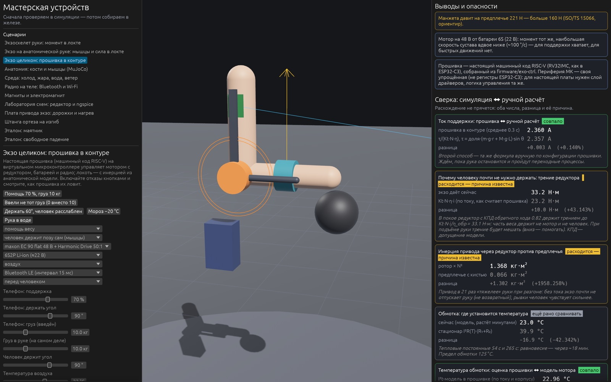

# Ночь 2, 21.11.2026: среда, электромагнетизм, схемы и платы, микроконтроллер с прошивкой, Wi-Fi и Bluetooth

Коротко: в мастерской теперь можно собрать и проверить не только каркас, но и сам рабочий
инструмент. Настоящая прошивка (машинный код RISC-V) крутится на виртуальном
микроконтроллере и управляет мотором с редуктором, батареей и связью с телефоном, а локоть,
которым она двигает, взят из анатомической модели. Вокруг — мороз, жара, вода, ветер.
Схемы пишутся прямо в окне и сверяются с ngspice. Каждый новый блок сверен вторым
независимым способом: **270 эталонных сверок, все проходят; 240 тестов зелёные**.

Симуляция уже поймала в прошивке две ошибки, которые на железе стоили бы сгоревшего мотора
и уроненного груза (п. 1 ниже). Обе исправлены и перепроверены.

## Что посмотреть

```bash
cd sim
cargo sim
```

Новые сценарии в списке:

| Сценарий | Что внутри |
|---|---|
| **Экзо целиком: прошивка в контуре** | прошивка `firmware/exo-ctrl` на МК «как ESP32-C3» → H-мост → мотор maxon + Harmonic Drive с нагревом → локоть (масса и инерция из MS-Human-700) ← человек; батарея LG M50 6S2P; Bluetooth/Wi-Fi до телефона. Кнопки отказов, редактор конфигурации прошивки, «Пересобрать прошивку» |
| **Среда: холод, жара, вода, ветер** | терморегуляция человека (Gagge, ASHRAE 55), обморожение, жара, холодная вода; касание рамы кожей, солнце на корпусе, конденсат, батарея и электроника, охлаждение мотора |
| **Радио на теле: Bluetooth и Wi-Fi** | бюджет линии по измерениям IEEE 802.15.6, тело за спиной, вода над устройством, живой пакетный канал |
| **Магниты и электромагнит** | сила между магнитами, магнит на стали, электромагнит с насыщением, магнит датчика угла локтя AS5600; силовые линии |
| **Лаборатория схем: редактор и ngspice** | нетлист SPICE редактируется в окне, 11 готовых схем, сверка кривых с ngspice одной кнопкой |
| **Плата привода экзо: дорожки и нагрев** | H-мост, шунт, стабилизатор, МК с линией к антенне: IPC-2221, температура переходов, 50 Ом двумя формулами |

В «Экзо на анатомической руке» появился выбор «Среда»: воздух, рука в воде, ветер.

Кадры — `docs/screenshots/` (новые: `exo_loop.jpg`, `exo_loop_jam.jpg`,
`environment_frost.jpg` / `_heat` / `_lake`, `radio_body_behind.jpg` / `_water`,
`magnets_latch.jpg` / `_electromagnet` / `_as5600`, `circuit_lab.jpg`, `pcb_board.jpg`,
`exo_anatomy_water.jpg`).



## Что сделано

| Блок | Что умеет | Чем проверено |
|---|---|---|
| `sim-mcu` + `firmware/` | ядро RV32IMC + Zicsr, прерывания, `wfi`, GPIO/ШИМ/АЦП/UART/радио/сторожевой таймер, загрузка ELF; прошивки на Rust: самотест и контроллер экзо (контур тока 10 кГц, угла 1 кГц, 10 защит) | 41 сверок: тот же код нативно на Mac побитово, 110 кодировок LLVM, спецификация RISC-V; ток поддержки ↔ ручной расчёт; времена реакции защит; оценка обмотки ↔ модель мотора |
| `sim-em` | Био–Савар, магниты, сила магнит–магнит и к стали, электромагнит с B–H, мотор с редуктором и нагревом (maxon, CubeMars) | 59 сверок: две формулы на каждую величину, замер K&J, паспорта maxon (≤ 0.74 %), энергобаланс |
| `sim-env` | воздух/вода, конвекция, ветро-холод, индекс жары, модель Gagge, погружение, контакт кожи с материалами (ISO 13732), солнце, пределы Li-ion/электроники/пластиков | 95 сверок: таблица ASHRAE 55 (22 строки, ≤ 0.042 К), все 216 клеток таблицы NWS, IAPWS/NIST, учебные примеры |
| `sim-radio` | вода и ткани на 2.4 ГГц, каналы на теле, ESP32-C3, бюджет линии, пакетный канал BLE/Wi-Fi | 12 сверок: две модели воды (≤ 0.6 %), PSS-78, Johnson & Guy, стандарты 802.11, задержка ↔ формула |
| `sim-circuit` | SPICE-подмножество, MNA, Ньютон, трапеции, пошаговый режим; батарея LG M50; расчёты плат | 45 сверок: аналитика (RC, RLC, Ламберт W, buck), **ngspice 47 на тех же нетлистах**, паспорт ячейки, IPC |
| `sim-mujoco/fluid` | рука в воде и на ветру | MuJoCo ↔ цилиндр вручную; MuJoCo не считает Архимеда — добавлено нами |
| ngspice 47 | внешний эталон для схем | собран из исходников, `assets/third_party/ngspice` |

## Главные находки (для устройства)

1. **Прошивка сожгла бы мотор при заклинивании.** В режиме удержания угла с заклиненным
   суставом прошивка держала 8 А бесконечно. Обмотка проходила предел 125 °C на ~80-й
   секунде, а датчик температуры стоит на корпусе и показывал 36 °C; снижение тока по
   корпусу началось бы только к ~190-й секунде, когда обмотка ~210 °C. **Исправлено**:
   в прошивке теперь есть защита от заклинивания и тепловая модель обмотки по току (I²t),
   её оценка совпадает с моделью мотора до 0.1 К. Пик обмотки при заклинивании — 28 °C.
2. **Первая версия этой защиты роняла груз.** Человек держит тяжёлый груз неподвижно, ток
   помощи упёрся в предел — через 1.5 с прошивка решала «заклинило» и бросала руку.
   **Исправлено**: заклинивание — только когда задано движение и его нет; при удержании
   обмотку бережёт плавное снижение тока; при настоящем заклинивании ток спадает за 0.2 с,
   а не обрывается. Обе ситуации теперь в тестах.
3. **Делитель батареи на плате рассчитан только на 6S.** С батареей 12S вход АЦП уходит за
   3.3 В, прошивка видит ~36 В и считает батарею севшей. Нужен делитель ~1:21 и новая шкала.
4. **Редуктор держит и мешает.** Отражённая инерция maxon + HD 50:1 — 1.37 кг·м², в 21 раз
   больше предплечья: экзо почти не отпускает руку без тока. В покое трение редуктора (КПД
   обратного хода 0.82) держит часть веса само — человеку почти ничего не остаётся, но при
   подъёме это же трение мешает.
5. **Вода.** Архимед снимает ~88 % веса руки — помощь «по модели веса», настроенная на
   воздух, в воде без груза задирает руку (нужен режим «вода» или датчик силы). Bluetooth на
   2.4 ГГц теряет ~3 дБ на сантиметр пресной воды и ~10 дБ — морской: связь пропадает на
   глубине 4–15 см. Мотор в воде охлаждается лучше и длительно держит 71 Н·м против 39 в
   комнате.
6. **Тело закрывает телефон**: в среднем +9 дБ потерь (до 19 дБ); сквозь тело сигнал не
   идёт (~100 дБ на 25 см мышцы), а огибает его. Антенну — на внешнюю сторону манжеты.
7. **Мороз и солнце у кожи.** Голая алюминиевая рама при −25 °C даёт на коже −22 °C —
   обморожение за секунды; чёрный анодированный корпус на солнце при +40 °C — 76 °C, ожог;
   PLA и PETG размягчаются. Подкладка из вспененного неопрена снимает обе проблемы. Li-ion
   нельзя заряжать ниже 0 °C; при входе с мороза в тепло на плате выпадает иней и вода.
8. **Жара +40 °C, солнце, работа**: ядро тела к 2 ч ~40.5 °C (тепловой удар), потеря воды
   ~0.8 л — экзо снимает механическую нагрузку, но не тепловую.
9. **Плата.** Дорожки 1 мм на меди 1 oz под 8 А греются на +161 К; по IPC-2221 нужно 3.5 мм
   (или 3 мм на 2 oz → +8 К). Линия к антенне 1.6 мм на FR-4 1.6 мм — 71 Ом вместо 50;
   нужна ~3 мм.
10. **Магниты.** Защёлка манжеты Ø10×5 N42 через 1 мм — 19 Н, а формула «двух диполей»
    даёт 77 Н: вблизи ей верить нельзя. Сила падает с зазором круто — через ткань защёлка
    почти не держит. Магнит Ø6×2.5 N35 для датчика угла AS5600 работает в зазоре
    0.09–2.5 мм от кристалла.

## Что можно делать прямо в окне

* **Схемы**: писать нетлист, «Применить» — считает наш решатель, «Сверить с ngspice» —
  тот же текст во внешней программе, расхождение кривых на панели.
* **Прошивка**: править конфигурацию (усиления, пределы, тепловую защиту) текстом —
  записывается в МК и перезапускает его; править код в `firmware/exo-ctrl` в редакторе и
  нажать «Пересобрать прошивку» — соберётся под RISC-V и загрузится в МК.
* **Отказы**: аварийная кнопка, обрыв датчика, заклинивание, пропала связь, зависание прошивки.
* **Среда**: мороз, жара, ветер, солнце, вода; материал рамы и подкладки, покрытие корпуса.

## Что найдено в данных производителей (не в нашей модели)

maxon EC 90 flat: пусковой момент на текущей странице 9.41 Н·м против 13.1 в каталоге
2022 и Kt·V/R = 13.14; номинальный момент 0.964 больше Kt·I_N = 0.938. CubeMars AK80-64:
Kv = 80 даёт Kt на 12 % меньше паспортного; скорость холостого хода и пиковый момент не
сходятся с остальными числами паспорта. Полный список — `sim_em::datasheet_discrepancies()`.

## Чего пока нет (честно)

* **Живое окно руками не проверено**: экран снова был заблокирован, все кадры сняты
  рендером в текстуру (тот же кадр, что в окне). Редакторы текста, кнопки и консоль
  работали в тестах, но мышью и клавиатурой в них никто не печатал.
* **Виртуальный МК — не регистры настоящего ESP32-C3.** Ядро то же (RV32IMC), логика
  прошивки та же, но для живой платы нужен слой драйверов (или эмулятор чипа). Модель
  тактов приближённая (±30 %).
* **Поля без 3D МКЭ** — точные формулы для простых форм; сердечник мотора не считаем.
* **Тепло человека — одно «среднее» тело**, руки и пальцы отдельно не считаются; на
  морозе и в воде модель Gagge — экстраполяция (на экране это написано).
* **Радио — бюджет по измерениям**, без расчёта антенны.
* **Плата — только IPC-2221**, без взаимного нагрева деталей; θJA зависит от платы ±50 %.
* **Батарея**: одно RC-звено; ниже 0 °C — экстраполяция; сопротивления частично из
  препринта (Lone 2025, без рецензии).
* Человек в «Прошивке в контуре» — простая модель (ПИД мышц с пределом 60 Н·м), не мышцы
  MuJoCo.

## Предлагаю дальше

1. **Прошивку — на настоящую плату ESP32-C3**: слой драйверов под реальные регистры, та же
   логика; стенд «железо в контуре» против того же симулированного локтя.
2. **Руки и пальцы в холоде**: многосегментная терморегуляция (JOS-3) — для перчаток и хвата.
3. **Плата из KiCad** → «Плата привода» (импорт `.kicad_pcb`, без линковки GPL-кода).
4. **Полный экзоскелет с путём нагрузки в ноги** (из прошлого отчёта).
